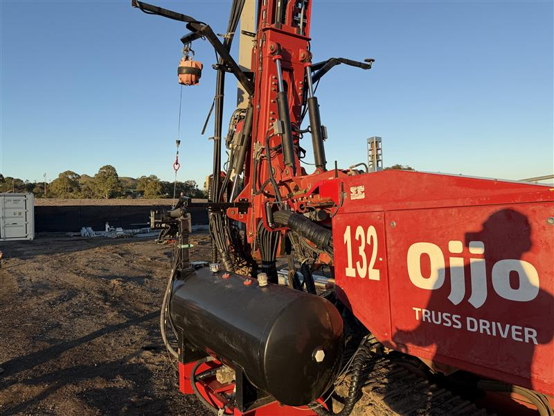

# Z-slide GPS antenna arms

Owner supplied November 3, 2026. The owner identified the black arms near the
upper part of the photo as the GPS antenna arms attached to the moving Z-slide.
The mast cap remains on the mast. This supersedes the interim simulator's
mast-mounted antenna crossbar. Arm shape/spacing are visual references, not
measured antenna offsets or calibration.

